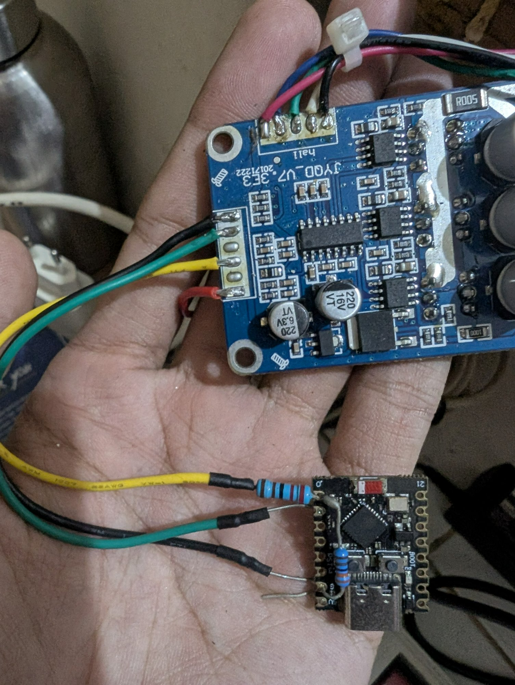

# Bench wiring — stock JYQD-V7.3E3 + ESP32-C3 Super Mini

How to run the firmware on a **standard JYQD-V7.3E3 driver board** with a bare
**ESP32-C3 Super Mini** module, before the custom PCB exists. The pin map is
identical to `PCB/V1`, so firmware tuned here transfers unchanged.



Source for the driver side: [`controller_specification/JYQD-V7.3E3-English.pdf`](controller_specification/JYQD-V7.3E3-English.pdf).
Motor data: [`motor_specification/42BLF.pdf`](motor_specification/42BLF.pdf).

## What you need

| Item | Note |
|---|---|
| JYQD-V7.3E3 | 12–36 V in, 16 A continuous / 15 A max |
| ESP32-C3 Super Mini | any variant, 16 pins |
| 10 kΩ potentiometer | gain trim, optional but recommended |
| 2.2 kΩ + 3.3 kΩ | FG divider (5 V → 3.3 V) |
| 100 Ω | series resistor, PWM → VR |

| 1 kΩ + 10 kΩ | EL level shift |
| LED + 560 Ω | ERR indicator, optional |
| 24 V supply | **separate 5 V/USB for the ESP32** |

## Driver control port (from the datasheet)

| Pin | Meaning |
|---|---|
| `5V` | Driver's own 5 V output. **Only for a potentiometer or switch** — the datasheet forbids powering external equipment from it |
| `Z/F` | Direction. 5 V or unconnected = forward, GND = reverse |
| `VR` | Speed input, 0.1–5 V analogue, **input resistance 20 kΩ**. Also accepts PWM 1–20 kHz, 0–100 % duty |
| `EL` | Enable. 5 V or unconnected = **runs**, GND = **forbidden to operate** |
| `Signal` | Speed pulse output (5 V, open collector) |
| `GND` | Control ground |

Power port: `P+` / `P-`. Motor: `MA` / `MB` / `MC`. Hall: `Ha` / `Hb` / `Hc` / `GND` / `5V`.

## ESP32-C3 pin map

Identical to the custom PCB and to `config.h`.

| GPIO | Function | Direction |
|---|---|---|
| 0 | RPM in — FG through the 2.2 k / 3.3 k divider | input |
| 1 | PWM out → VR | output |
| 2 | **unused** — boot strapping pin, leave floating | — |
| 3 | Trim pot wiper (ADC1_CH3) | analogue in |
| 4 | EL enable (open drain) | output |
| 5 | ERR LED | output |
| 3V3 / GND | logic supply and ground | — |

## Wiring

### Power

```
24 V supply ── P+ (JYQD)          ESP32-C3 ── USB or its own 5 V pin
24 V supply ── P- (JYQD)          ESP32 GND ── JYQD GND   (common ground!)
```

⚠️ **Do not power the ESP32 from the driver's `5V` pin.** The JYQD datasheet
forbids it, and in practice the rail sags enough to cause RPM jitter the moment
USB is unplugged.

### FG → GPIO0 (5 V to 3.3 V)

```
JYQD Signal ──[ 2.2k ]──┬── GPIO0
                        └──[ 3.3k ]── GND
```

2.2 k / 3.3 k gives 5 V × 3.3/(2.2+3.3) = **3.0 V**, safely inside the 3.3 V
input. This is exactly what R4/R5 do on the PCB.

### PWM → VR

Straight through a series resistor:

```
GPIO1 ──[ 100R ]── VR (JYQD)
```

The datasheet explicitly supports PWM on `VR` (1–20 kHz, 0–100 % duty) — the
driver averages it internally. Duty 0 % → 0 V → stop; duty 100 % → 3.3 V → fast.
**Non-inverting**, matching what the firmware expects.

Do **not** put a transistor inverter in this path. An earlier board revision
used an open-drain N-MOSFET with a 5 V pull-up to reach 5 V logic, which
inverted the control: idle became full speed and the PID ran as positive
feedback. It has been removed.

**Why 3.3 V and not 5 V:** the ESP32 tops out at 3.3 V, and the JYQD maps
0.1–5 V to 0–100 % speed, so the usable range is about **66 % of maximum**. On a
42BLF20 (4000 RPM rated) that is ≈ 2640 RPM, comfortably above the 1440 RPM
target. If you ever need more, a non-inverting level shifter is the answer — not
an inverter.

### EL → GPIO4 (enable)

```
JYQD 5V ──[ 10k ]──┬── EL (JYQD)
                   │
GPIO4 ──[ 1k ]─────┘
```

`EL` high or floating = the driver runs. GPIO4 pulls it low through 1 kΩ to
forbid operation. So the motor is **enabled by default** and the firmware has to
pull it down to stop — the safe direction if the ESP32 resets.

### Trim pot

```
3V3 ──[ 10k pot ]── GND
          │
       wiper → GPIO3
```

Always active in the firmware: midpoint is 1.0× gain, range 0.75×–1.25×.

### ERR LED

```
GPIO5 ──[ 560R ]──|>|── GND
```

### Motor and Hall

| JYQD | To |
|---|---|
| `MA` `MB` `MC` | motor phases |
| `P+` `P-` | 24 V supply |
| `Ha` `Hb` `Hc` | Hall sensors (120° electrical) |
| `5V` `GND` (hall port) | Hall sensor supply — this port **is** meant to power the halls |

If the motor cogs or runs rough, swap two phases **or** two Hall wires — not
both. Only one of the two orders is wrong.

## Bring-up order

1. **No motor.** Power the ESP32 from USB only, open the console at 115200.
   Confirm the banner and that `GPIO 3 (trim)` shows a value that changes when
   you turn the pot.
2. **Driver powered, motor disconnected.** 24 V on `P+`/`P-`, current limit
   300 mA. The driver should draw only its quiescent current.
3. **Check VR.** Set a target and measure VR with a multimeter: it should move
   between ~0.1 V and ~3.3 V as the duty changes. If it sits at 5 V or 0 V and
   never moves, the MOSFET or its gate resistor is wrong.
4. **Hall check.** Connect the Halls, turn the shaft by hand, confirm the console
   RPM follows your hand.
5. **First spin.** Motor connected, shaft free, current limit 500 mA, low target.
6. **Tune.** Adjust the pot, watch the response, then bake the values into
   `config_common.h`.

## Limits worth knowing

- **Current.** The JYQD is rated 16 A continuous, but the 42BLF family comes in
  1.9 A / 3.4 A / 5.7 A rated variants with peak currents of 5.7 / 10.2 / 18 A.
  The **5.7 A rated (78 W) variant exceeds what the custom PCB can carry** —
  see the copper sizing section in [`../PCB/V1/README.md`](../PCB/V1/README.md).
  The 26 W (1.9 A) and 52 W (3.4 A) variants are fine.
- **`PULSES_PER_REV`.** The 42BLF is 8-pole, and the driver XORs the three Hall
  signals into one square wave, giving 4 pulses per revolution — that is the
  firmware default. A different motor needs this recalculated.
- **Direction.** `Z/F` is a static level, not a PWM input. The firmware does not
  drive it; wire it to GND or leave it floating, and change direction there.
- **Hall supply.** The Hall port's `5V` is the one output the datasheet *does*
  intend for external use.
